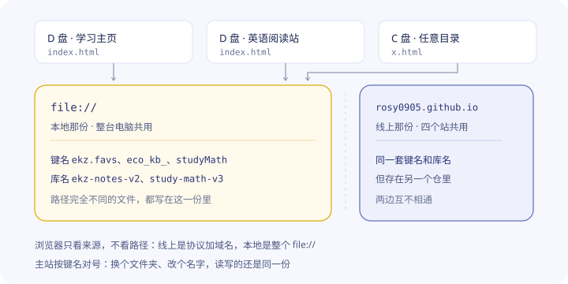

# 主站使用帮助 · 数据与备份

主站是打开四个学习站的那个首页。页面右上角有一个圆形按钮，点开后展开导入、导出、清除三个小球。主站自己不产生学习数据，只负责汇总这四个站。这份文档说明三件事：数据存在哪里，清除会删掉什么，屏幕上出现提示时该怎么办。

文中反复出现的几个说法，先统一：

- **本机**：你正在使用的这台设备，以及这台设备上这个浏览器保存的数据。同一台设备上，用线上网址打开和双击本地文件打开，算两个不同的本机，原因见第一节末尾。
- **备份文件**：用导出球生成出来的那个 `.json` 文件。
- **四个站**：经济学、数学三、英语阅读、单词速刷。

---

## 一、三个小球

| 小球 | 做什么             | 需要注意                                 |
| -- | --------------- | ------------------------------------ |
| 导入 | 把备份文件里的数据写回本机   | 会覆盖本机已有的同名数据；本机已存的 AI 密钥不会被文件里的旧密钥覆盖 |
| 导出 | 把本机的数据打包成一个备份文件 | 有数据的站默认勾选，没有数据的站不能勾，也可以只勾其中几个站       |
| 清除 | 删除本机上勾选站点的数据    | 会先列出每个站有多少条记录，再让你确认一次                |

一句话区分：导入和导出处理文件，清除处理本机数据。

条数和文件大小只出现在三个地方：导出窗口里每个站那一行、清除窗口里每个站那一行、导入窗口里对所选文件的预览。页面别处都不显示条数。条数怎么算见第四节。

### 用网址打开，不要双击文件

三个小球都作用在浏览器里保存的那份数据上，所以先说明一件事：主站必须用线上网址打开。

主站和四个站都在 `rosy0905.github.io` 这个网址下。浏览器按来源分配存储空间：同一个来源的页面共用一份数据，所以主站能读到四个站的数据，四个站也能读到主站写进去的东西。

把 `index.html` 下载到电脑上双击打开，地址栏会变成 `file:///D:/...` 开头。浏览器把整个 `file://` 当成一个来源，单独分配一份数据。电脑上所有双击打开的本地网页共用这一份，不分盘符，不分文件夹，也不限于这四个站，别的项目、旧版本、不相干的本地网页，写的都是同一份。

这时导入会有两个结果：

- 导入窗口照常提示成功，条数也照常显示，因为数据确实写进去了；
- 写进去的是 `file://` 这一份，线上四个站读的是它们自己那一份，刷新也不会变。

反过来也一样，线上导入的数据，双击打开的那个页面看不到。

判断方法只看地址栏：`https://` 开头才是线上，四个站互通；`file://` 开头或者直接显示盘符路径，就是本地文件，数据不通用。

主站换个文件夹也找得到四个站，靠的不是路径，是存储里的名字。它按每个站固定的键名前缀和库名去对号：经济学是 `eco_kb_`、`micro_recite_` 这类前缀，数学站是 `studyMath` 加 `study-math-v3` 库，阅读站是 `ekz` 加 `ekz-notes-v2` 库。导入按这些名字写，导出按这些名字读，所以主站放在哪个文件夹、文件改叫什么名字，都不影响。

反过来，两个副本同时开着，写的是同一份数据，同名键会互相覆盖，数字来回跳就是这个原因。

*图：浏览器按来源分仓，路径不参与判断。三个文件不管放在哪，写的都是 `file://` 这一份；右边那份是线上，两仓互不相通。*

这两份数据都在同一个浏览器里，放在同一个配置文件夹，只是按来源分开存。线上和本地互不覆盖，双击打开不会弄坏线上的数据，只是彼此看不到。

`file://` 这一份只属于当前这个浏览器。换一个浏览器，或者开无痕窗口再双击打开，看到的是另一份空的。电脑上留着的旧副本则相反，双击打开读到的就是这一份，在里面导入或清除会改到它，所以旧副本不要双击，日常只用线上网址。

还有一点顺带说明：`rosy0905.github.io` 上只存放网页文件，你的笔记、进度、卡片都不在上面，一直只存在你自己的浏览器里。换设备或者清了浏览器数据，只能靠备份文件恢复。备份文件本身是普通文件，记的是导出那一刻的内容，在双击打开的页面里导出，拿到的可能是空的或很早以前的旧数据，所以导入和导出都在线上做。

## 二、四个站各自存了什么

浏览器按来源给页面分配一块本地存储（localStorage），同一来源的页面共用这一块，数据在里面按**键**存放，一个键对应一份设置或一组记录。数学站和阅读站另外还有数据库（IndexedDB），数据在数据库里按**行**存放。键和行都会计入条数，规则见第四节。

### 经济学（只有本地存储，没有数据库）

| 用途        | 键                                                                                                                | 内容                                                                                                        |
| --------- | ---------------------------------------------------------------------------------------------------------------- | --------------------------------------------------------------------------------------------------------- |
| 学习模块（8 个） | `micro_recite_` `macro_recite_` `calc_key_` `calc_special_` `micro_short_` `macro_short_` `essay_` `past_exams_` | 依次对应 1 背诵（微观）、2 背诵（宏观）、3 计算要点、4 计算专项、5 简答专项（微观）、6 简答专项（宏观）、7 论述专项、8 历年真题。每个模块一组键，分别存收藏、笔记、改过的内容、筛选条件、自测开关 |
| 学习进度      | `eco_kb_progress` `eco_kb_progress_at` `eco_kb_tts_rate`                                                         | 进度正文、最后一次保存的时间、朗读语速                                                                                       |
| AI 配置     | `ai_assistant_cfg_v1` `ai_assistant_size_v1` `ai_assistant_sys_ver`                                              | 提示词等配置（API 密钥存在第一个键里）、AI 面板尺寸、AI 功能版本号                                                                    |
| AI 对话历史   | `ai_assistant_history_v1`                                                                                        | AI 答疑助手的全部对话                                                                                              |
| AI 卡片记忆   | `ai_cards_last_cfg`                                                                                              | 在 AI 答疑里点「存成卡片」时选的分类（微观、宏观）和章节，记住下次弹窗的默认选项，只有一小段                                                          |
| 我的卡片      | `custom_cards_v1` `custom_chapters_v2`                                                                           | 自己整理的卡片和章节                                                                                                |

经济学的条数通常是几十条，这是正常的。一个学习模块只要动过收藏、笔记、筛选条件或自测开关中的任一项，就会写出好几个键，8 个模块加起来数量自然不小。

### 数学三（1 个本地存储键 + 1 个数据库）

| 存在哪                               | 是什么                     | 算不算学习数据        |
| --------------------------------- | ----------------------- | -------------- |
| 本地存储的 `studyMathSeedVer`          | 题库版本号，用来判断要不要重新灌题库      | 不算             |
| `study-math-v3` 数据库的 `problems` 表 | 题目题库本体，跟着站点一起下载，不是你做的记录 | 不算             |
| `study-math-v3` 数据库的 `status` 表   | 每道题的对错标记（对、错、未做）        | 算，这是数学站唯一的学习数据 |

`status` 表一行算 1 条。显示 8 条，表示标记过 8 道题。

### 英语阅读（本地存储 + 2 个数据库）

本地存储里的键分三类。

- **主页标记**：`ekz.favs` 收藏、`ekz.done` 学完、`ekz.recent` 最近学习，各算 1 条。
- **版面设置**：分屏比例 `ekz-split-ratio`、复盘分屏 `ekz-rv-split-ratio`、复盘栏宽 `ekz-rv-lvlock` `ekz-rv-rvlock`、荧光笔浓度 `ekz-hl-alpha`、页面缩放 `ekz-zoom-`（每篇文章各记一个）。动过哪一项就有对应的键，各算 1 条。
- **运行时状态**：笔迹备份、自检日志、步数记忆、画笔偏好。每次打开文章或动笔都会写，不算条数，完整清单在第四节。

数据库有两个。

| 数据库                        | 是什么                       |
| -------------------------- | ------------------------- |
| `ekz-notes-v2` 的 `notes` 表 | 全部笔记，一篇算 1 条              |
| `ekz-notes-db`             | 迁移之前的旧笔记库，只有老设备上才有，新设备上没有 |

举个例子：本机有 13 篇笔记，收藏、学完、最近学习这 3 个键也都写过，显示就是 16 条。之后又打开过几篇文章，多出几个笔迹备份和步数记忆键，显示仍然是 16 条，因为这些键不计入条数；如果还调过分屏比例、荧光笔浓度这类版面设置，每项各多出 1 条，缩放过哪篇文章就为那篇多 1 条，同样正常。

### 单词速刷（只有本地存储）

| 键             | 存什么    |
| ------------- | ------ |
| `dkz.chk.v1`  | 已勾掉的单词 |
| `dkz.mode.v1` | 当前模式   |
| `dkz.pos.v1`  | 翻页位置   |
| `dkz.view.v1` | 视图设置   |
| `dkz.q.v1`    | 搜索词    |

这 5 个键里有几个就算几条。比如只用过勾词和模式，显示 2 条；5 个都用过，显示 5 条。

## 三、站内清空和主站代清不是一回事

**站内清空**：在那个站自己的页面上点清空，删掉页面上列出的那些内容，其余保留。  
**主站代清**：在主站清除窗口里勾选，按第四节那张三种口径表，把这个站的数据全部删掉。

| 站点   | 站内清空删什么                                      | 主站代清删什么                               |
| ---- | -------------------------------------------- | ------------------------------------- |
| 经济学  | 勾选的模块键 + 进度三个键。AI 配置、AI 对话历史、AI 卡片记忆、我的卡片都不删 | 这个站的全部键，包括 AI 配置、AI 对话历史、AI 卡片记忆、我的卡片 |
| 数学三  | 只有一个「清空正误」按钮，删 `status` 表，题库保留               | 和站内一样，只清 `status` 表，题库和版本号都不动         |
| 英语阅读 | 全部键 + 两个笔记库里的记录，但保留 `ekz-wiped-` 记号          | 同上，同样保留记号；笔记库本身保留，只清空里面的记录            |
| 单词速刷 | 五个 `dkz.` 键全删                                | 同左                                    |

主站代清经济学会把 AI 配置一起删掉，其中包含 API 密钥。清完再打开 AI 助手会提示需要配置，要把密钥重新填一次。站内清空不删 AI 配置，密钥还在。

下面两种情况是正常的，不是出错。

1. **经济学站内清空之后，主站还显示一批数据。** 站内清空只清勾选的模块键和进度三项，剩下的是 AI 配置、AI 对话历史、AI 卡片记忆、我的卡片。其中对话历史在 AI 面板的「清空对话」里清，我的卡片在卡片页的清空里清；AI 配置和 AI 卡片记忆没有单独的清除入口，要清就用主站代清。
2. **主站代清之后，浏览器的 IndexedDB 里还能看到 `ekz-notes-v2` 这个库，只是里面 0 条。** 这是正常的。主站清的是库里的表，不是删掉整个库，所以不受其它页面是否开着这个库影响，点了就生效。留下的空库占不了多少空间，也不影响之后导入。

## 四、条数是怎么算的

规则只有一句：**本地存储每个键算 1 条，数据库每行算 1 条。** 下面这些不计入。

| 站    | 不算条数的东西                                                                                                      | 为什么不算                     |
| ---- | ------------------------------------------------------------------------------------------------------------ | ------------------------- |
| 数学三  | `problems` 题库表、`studyMathSeedVer` 版本号                                                                        | 题库是站点内容，不是你的记录            |
| 英语阅读 | `ekz-ink-bk-` `ekz-ink-bkts-` 笔迹备份、`ekz-debug-log-v2` 自检日志、`ekz-migrated` 迁移标记、`ekz.pos.` 步数记忆、`drawn.` 画笔偏好 | 不是学习记录，是界面状态 |
| 英语阅读 | `ekz-wiped-` 清空记号                                                                                            | 防复活用的记号，见第五节              |

单独列出来的原因：笔迹备份和步数记忆每翻一篇文章就会新写几个，算进条数的话，条数会随翻看次数一直涨，反映不出真实的学习记录；画笔偏好只在改笔刷时写一次。

同一个站的数据，在三种操作里的口径不完全一样。

| 数据                                                         | 算条数 | 导出备份 | 清除 |
| ---------------------------------------------------------- | --- | ---- | -- |
| 学习记录与设置（主页标记、笔记、学习模块、学习进度、AI 配置、AI 对话历史、AI 卡片记忆、我的卡片、版面设置） | 算   | 带    | 删  |
| 画笔偏好 `drawn.`、步数记忆 `ekz.pos.`                              | 不算  | 带    | 删  |
| 笔迹备份、自检日志、迁移标记                                             | 不算  | 不带   | 删  |
| 清空记号 `ekz-wiped-`                                          | 不算  | 不带   | 保留 |

画笔偏好和步数记忆属于设置，不是记录，所以不计入条数：画笔偏好只在改笔刷时写一次，步数记忆每翻一步更新一次。导出仍然会带上，换设备后不用重设。

## 五、清空记号 `ekz-wiped-` 是什么

阅读站清空数据时，每清掉一条记录会留下一个 `ekz-wiped-<记录编号>` 的键，里面只有一个时间戳。这是阅读站的防复活机制：如果清空时还有别的标签页开着，那些页面内存里存着旧笔记，可能在关闭时把旧数据写回来，记号就是用来拦住这种写回的。

记号不是学习数据，所以主站计数、导出、清除三处都不碰它，清除窗口里阅读站的条数只算学习记录。主站代清阅读站时也会把记号留下，不破坏防复活机制。

## 六、导出备份包含什么

- 四个站的学习数据，加上设置（版面设置、画笔偏好、步数记忆），以及各站数据库里的记录
- **不带**笔迹备份、自检日志、迁移标记、清空记号。笔迹备份是笔记副本，自检日志是诊断日志，迁移标记和清空记号只是标记，带出去只会把文件撑大，导回来还可能把刚清掉的笔迹灌回去
- **数学站例外**：只带 `status` 正误标记，题库不进备份。题库是随站点发布的内容，换设备后打开数学站会按版本号自动重灌，不用担心丢题
- AI 配置导出时自动剔除 API 密钥，避免备份文件泄密；导入时保留本机已有的密钥，不会被文件里的旧值覆盖
- 备份文件是纯 JSON 文本，不含任何可执行代码。每次大改动前导一份，换电脑或清浏览器之后导入就能还原

## 七、屏幕上出现这些提示，怎么处理

下表的提示一列是屏幕上的原文。条数和文件大小会随数据量变化，表里用 `N` 和常见数值举例，你看到的数字会不一样。

「数据库没读全」这句只出现在导出窗口和清除窗口。导入窗口显示的是文件里带了多少条，不会出现这句。英语阅读和数学三都有可能出这句，哪个站读不出来就报哪个站。

### 导出窗口、清除窗口里每个站下面那行小字

| 显示                       | 意思                                 | 怎么做                                                           |
| ------------------------ | ---------------------------------- | ------------------------------------------------------------- |
| `16 条记录 · 1.19 MB`       | 数据全部读到了                            | 不用管                                                           |
| `3 条（数据库没读全，重开这个窗口再试）`   | 数据库这一次没有打开，3 条只数了本地存储里的键，不是数据的真实条数 | 关掉这个窗口，等几秒重新点开，主站会重新数一遍（切到别的标签页再回来也会立即重数）；仍然这样，就把其它站的页面全部关掉，再刷新主站 |
| `数据库暂时读不出来，关掉其它站页面后刷新再试` | 一条都没有读到                            | 先把其它站的页面全部关掉（手机上从桌面图标打开的那个阅读站也算），再刷新主站                        |
| `本机暂无数据`                 | 确实没有数据                             | 刚清空过就是正常的；没有清空过却这样显示，直接导入备份                                   |

### 点导入之后

| 提示                                                              | 意思                                            | 怎么做                                     |
| --------------------------------------------------------------- | --------------------------------------------- | --------------------------------------- |
| `正在导入…`                                                         | 文件已经读进来，正在往库里写。写入超过半秒还没完成才会出现，很快的话不会出现，直接看到成功 | 不用操作，等它换成下一句                            |
| `还在导入，数据量比较大…`                                                  | 写了 3 秒还没结束                                    | 继续等，通常几秒内就结束                            |
| `还没导入完，可能被其它站的页面占着，关掉它们再试`                                     | 写了 8 秒还没结束，多半是别的页面占着库                         | 把其它站的页面全部关掉，再导入一次                       |
| `导入成功！N 条记录已恢复，刷新各站即可看到`                                        | 每条数据都已经写完                                     | 刷新各站就能看到                                |
| `导入没全成功：英语阅读（ekz-notes-v2：被别的页面占着，打不开）。先把其它站的页面都关掉，只留这一页，再导入一次` | 有数据库没写进去，括号里写明了是哪个库、什么原因                      | 把其它站的页面全部关掉，只留主站这一页，再导入一次。重复导入是覆盖写，不会翻倍 |
| `导入失败：不是有效的 JSON 文件`                                            | 这个文件不是备份文件，或者文件已经损坏                           | 换一个备份文件                                 |
| `导入失败：文件格式不正确` / `导入失败：不是主站的备份文件` / `文件里没有可识别的站点数据`             | 文件不是主站导出的备份                                   | 换一份主站导出的备份文件                            |

手机上通常 1 到 4 秒出结果，写得快的时候连「正在导入」都不会出现，直接报成功。写入一直卡住时，最长 20 秒也一定会给结果，中途那几行提示会一直留在屏幕上，不会出现没有任何提示的空白等待。

### 点导出之后

| 提示                                             | 意思                                   | 怎么做                            |
| ---------------------------------------------- | ------------------------------------ | ------------------------------ |
| `导出成功！N 条记录已保存`                                | 文件内容完整                               | 可以直接用                          |
| `注意，这份备份不完整：英语阅读的数据库没读出来。别拿它换设备，先关掉其它站页面重新导一次` | 文件里缺了这一站数据库里的记录，冒号后写着是哪个站，数学三也可能出现这句 | 不要用这份文件换设备。关掉其它站页面、刷新主站，重新导出一次 |
| `至少勾选一个站`                                      | 导出时一个站都没勾                            | 勾选要备份的站再点导出                    |
| `选中的站都没有数据`                                    | 勾选的站确实没有数据                           | 取消勾选这些站，或先学一点再导出               |

### 点清除之后

| 提示                | 意思     | 怎么做        |
| ----------------- | ------ | ---------- |
| `先勾选要清除的站`        | 一个站都没勾 | 勾选要清的站再点确认 |
| `正在清除 经济学…`       | 正在删除   | 等它结束       |
| `已清除 经济学，刷新各站后生效` | 已经清空   | 刷新各站即可     |
| `清除出错了，刷新页面再看`    | 异常     | 刷新页面后重试    |

如果清除窗口打开后只有一句 `本机四个站都没有数据，没什么可清除的。`，说明本机确实没有数据，直接关掉窗口即可。

### 点了小球，窗口不出现，或者闪一下就没了

强制刷新一次。电脑按 `Ctrl + F5`，手机清一下浏览器缓存再打开页面。页面加载的还是缓存里的旧脚本时，会出现这种情况。

## 八、常见问题

**Q：主站代清数学站，题库会被删掉吗？**  
不会。只清 `status` 正误表，`problems` 题库和 `studyMathSeedVer` 版本号都不碰，和站内「清空正误」是同一个动作。

**Q：数学站清完正误，主站还会显示题目吗？**  
不会。主站只把 `status` 表算作记录，题库不计入条数，所以清完就显示 0 条。

**Q：清除窗口里某个站不显示？**  
列表只列出有数据的站，确实没有数据的站不会出现；读数失败的站也会列出来，并在那一行写明没读全。如果某个站明明有数据却不显示，按第七节「数据库没读全」那条处理。

**Q：导入备份会覆盖本机已有的数据吗？**  
会。本地存储的键和数据库里的记录都按文件内容覆盖写入。导入前想留个底，先导出一份当前状态。

**Q：双击打开网页，导入提示成功，但线上四个站没有变化？**  
因为双击打开的是本地文件，浏览器把它当成另一个来源，数据写进了 `file://` 那一份，与线上那份互不相通，所以线上站点看不到。改用线上网址打开主站，重新导入一次即可。判断方法见第一节末尾。

**Q：经济学站自己也能导出，和主站导出的有区别吗？**  
有区别，但日常备份用哪个都行。

- 选项不同：经济学站自己的导出窗口分三项，学习数据（必导）、AI 配置、AI 对话历史，默认全部勾选，可以按需取消；主站导出不分项，四个站的数据一次全部打包
- 内容一致：三项都勾选时，带的数据和主站导出的这个站相同；取消某一项，备份里就少那一类
- 两边都会自动剔除 API 密钥，备份文件里不会出现密钥

主站一次能出四个站，更省事，建议日常备份用主站。
